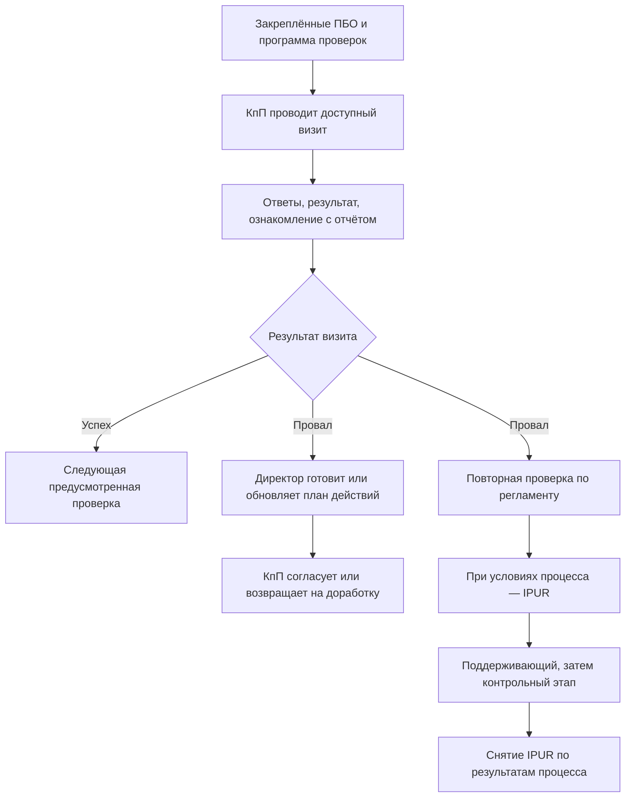

# КпП в ПУСК: роль, рабочий цикл и последствия для X3

Дата: **13.10.2026**. Основание: переданный пользователем контекст основного проекта,
уже согласованная аудитория X3 — КпП с несколькими ПБО — и просьба заново понять роль.

**Главный вывод:** КпП — консультант по производству, основной исполнитель визитов
на закреплённых предприятиях и участник согласования корректирующих планов.
Рабочая модель охватывает программу проверок и действия после результата.
Заполнение конкретного чек-листа — один этап этой работы. Для X3 это означает
обзор своего портфеля с переходами к конкретным действиям, а затем к предприятию и визиту.
Такой вывод следует из материалов; удобство будущего интерфейса с КпП ещё не проверено.

## 1. Основание и степень уверенности

Пакет полностью сохранён в [reference/pusk-context-2026-10-13](../reference/pusk-context-2026-10-13/README.md).
Ниже «описано/зафиксировано» относится к содержанию переданного пакета.
В этой работе вход в ELMA, проверка прав на живом стенде и проверка Трекера не выполнялись.
Статус «подтверждено» в исходном документе — результат работы его автора, а не новая проверка.

| Источник | Дата/статус | Применение |
| --- | --- | --- |
| [Описание проекта](../reference/pusk-context-2026-10-13/contents/pusk/wiki/yandex-04-opisanie-proekta.md), §2–7 | Ревью 07.10; бизнес-правила ещё ревьюируются | Определение роли, процессы, ограничения |
| [Матрица ролей](../reference/pusk-context-2026-10-13/contents/pusk/домен/матрица-ролей-и-экранов.md) | Прогон 05.10 и более ранние источники | Разделение КпП/директора/МпП/лидера; учитывать устаревшие ячейки |
| [Путь КпП](../reference/pusk-context-2026-10-13/contents/pusk/прототип/ПУТЬ-КПП.md) | Наблюдения stage 02.10 | Экраны и задачи конкретного прохода; не универсальные правила всех чек-листов |
| [Сверка стенда 08.10](../reference/pusk-context-2026-10-13/contents/pusk/runs/proto_compare_20261008/СРАВНЕНИЕ-стенд-прототип-2026-10-08.md) | Более поздние наблюдения | Обновление доступа к ПД, фильтров ПБО; неопределённость формул |
| [Бизнес-правила](../reference/pusk-context-2026-10-13/contents/pusk/домен/бизнес-правила.md) | Смесь подтверждённых правил и черновиков QA | Основания повторных визитов, IPUR, ПД; сохранять статус каждого правила |
| [Архитектура наших вариантов](prototype-architecture.md) | Текущие решения пользователя 13.10 | Реальное состояние X1/X2/X3, принятая демо-формула и границы внедрения |

Также просмотрены архивные изображения `02_dashboard_after_click.png` и
`10b_reports_pd_loaded.png` из сверки 08.10. Второй кадр показывает роль КПП
и таблицу согласованных файлов ПД; он поддерживает более поздний журнал,
который сообщает о снятии прежнего 403. Это снимок stage, не проверка текущих прав.

## 2. За какие данные отвечает КпП

В источниках различаются два механизма:

- Группа-роль пользователя определяет доступ к разделам и группам прохождения чек-листов.
- Поле «КПП» в карточке конкретного ПБО связывает предприятие с исполнителем,
  задачами и уведомлениями. Поле одиночное на одном ПБО; одна учётка может быть
  указана у нескольких предприятий. Набор «моих ПБО» следует получать из этих привязок.

Выбранное в интерфейсе предприятие — контекст конкретного визита. Оно не должно
скрывать остальные закреплённые ПБО или незавершённую работу по ним. Роль пользователя,
доступный портфель, выбранное ПБО и назначенный исполнитель задачи — разные сущности.
Права просмотра старого результата при смене закрепления нужно уточнить отдельно.

**Наш X3 сейчас:** демонстрационный список ПБО и визиты, сохранённые на устройстве.
Привязки из ELMA/HR и рабочие права доступа не подключены. Пять карточек в демо
не подтверждают реальное закрепление пяти предприятий за пользователем.

## 3. Что КпП делает сам и с кем взаимодействует

| Работа | КпП | Другие участники / система |
| --- | --- | --- |
| Программа визитов | Просматривает выполнение по своим ПБО, выбирает доступный визит | Количество/период/группы задаются в чек-листе; служебные процессы контролируют цикл |
| Основной визит | Выбирает реквизиты, знакомится с условиями, отвечает, сохраняет/завершает | Система создаёт задачи, рассчитывает результат и формирует отчёт |
| Результат | Знакомится с итогом и основаниями, открывает ответы/PDF | Система фиксирует завершение и запускает предусмотренные последствия |
| Повторный визит | Исполняет назначенную проверку по доступному составу и сроку | Система использует «Регулирование визитов»; это может быть часть разделов |
| План действий | Согласует или отклоняет полученный план | Директор ПБО создаёт/обновляет задачи и действия; при отклонении дорабатывает |
| IPUR | Проводит предусмотренные повторные/поддерживающие проверки, видит стадию и задачи | Процесс ставит/снимает ПБО, организует поддерживающий и контрольный этапы |
| Администрирование | Использует нужную для выполнения информацию | Лидер проекта настраивает чек-листы и регламенты; это отдельная роль |
| Верификация КпП | Является объектом проверки навыков | МпП инициирует и заполняет верификацию своего КпП; это отдельный сценарий |

Материалы определяют КпП как исполнителя и согласующего. Из них нельзя автоматически
вывести, что КпП сам редактирует регламент визитов, создаёт ПД вместо директора,
закрывает все корректирующие действия или вручную снимает IPUR.
Критический ответ в последнем аудите также не является доказательством текущего
открытого нарушения: для этого нужен статус соответствующего действия.

## 4. Рабочий цикл

Переданный пакет описывает годовой цикл, на проде 01.02–31.01. Периоды и обязательное
количество зависят от чек-листов; их нельзя заменить количеством заполненных форм.

Это схема ролей и последствий, не точная спецификация запуска всех БП.
Ветки ПД и повторной проверки показаны раздельно: зависимость проведения повторного
от согласования ПД материалами однозначно не установлена. Порядок задач, сроки,
исключения и сочетание параллельных процессов требуют подтверждения владельцем процесса.

Описаны особые случаи: повторный может содержать только назначенные разделы;
IPUR учитывает провалы по направлению, а не просто число «Нет»; NABIT не запускает
повторный/IPUR; для ВпУПнВУ есть отдельное условие немедленного IPUR. Эти правила
нельзя без уточнения перенести в один демонстрационный аудит безопасности пищи.

## 5. Что КпП должен понимать с главной X3

Это **предложение по приоритетам**, выведенное из роли; новые экраны и механики
этим документом не считаются внедрёнными или утверждёнными.

| Вопрос пользователя | Нужная информация | Следующее действие |
| --- | --- | --- |
| Что сейчас ждёт меня? | Назначенные проверки, черновики, планы на моём согласовании; срок только из источника | Продолжить визит, открыть назначение или согласование |
| По каким ПБО не выполнена программа? | Обязательные визиты, зачтённые результаты, исключения, период и покрытие | Выбрать предприятие и нужную проверку |
| Где нужна повторная проверка? | Назначение, направление/разделы, срок, последний результат | Открыть конкретную задачу |
| Что происходит с IPUR? | Текущий статус, дата постановки, стадия, следующая проверка | Перейти к действию по процессу |
| Какие планы требуют моего решения или актуализации? | Статус согласования, версия/дата, условия актуальности | Согласовать/отклонить либо просмотреть статус работы директора |
| Почему предприятие требует внимания? | Последний результат с датой, критические ответы, история сопоставимых визитов | Открыть основание и связанное действие |

Главная должна помогать перейти от сведения к действию. Последний процент по аудиту
полезен как основание, но не заменяет выполнение программы, статус IPUR или актуальность ПД.
Общая оценка нескольких ПБО может скрыть конкретное предприятие, поэтому доступ
к отдельным ПБО сохраняется при любом агрегировании.

## 6. Сопоставление с тем, что уже сделано

| Возможность | Состояние нашего X3 | Что даёт пакет |
| --- | --- | --- |
| Портфельный обзор, поиск, фильтры, продолжение черновика | Реализовано локально | Подтверждает выбранную аудиторию; раскрывает происхождение «моих ПБО» |
| Аудит 48 вопросов, предварительная проверка/PDF, результат | Реализовано по решениям пользователя | Позволяет сопоставить с процессом ознакомления и последствиями завершения |
| План визитов | «Нет данных» | Описывает требуемые визиты, цикл, исключения; точный расчёт ещё нуждается в сверке |
| Повторные визиты/IPUR | «Нет данных» | Даёт процесс и роли; одного критического ответа для статуса IPUR недостаточно |
| Согласование и актуальность ПД | «Нет данных» | Показывает важную работу КпП, которую текущий аудит ещё не покрывает |
| Матрица результатов, разделы, замечания, история | Отдельная галерея концепций | Помогает поставить аналитику после рабочих задач, а не подменить ею программу |
| Рабочие привязки/права/реестр | Не подключены | Указывает необходимые источники, не поставляет работающую интеграцию |

Для дальнейшего X3 стоит сначала уточнить очередь действий КпП и модель его портфеля,
затем согласовать показатели программы/IPUR/ПД, после этого выбирать графики.
Это корректировка приоритетов обсуждения; работающий интерфейс в данной задаче не менялся.

## 7. Противоречия, которые нельзя скрыть

| Тема | Что расходится | Как учитываем |
| --- | --- | --- |
| Отчёты по ПД у КпП | Матрица 05.10/описание 07.10: 403. Журнал и кадр 08.10: таблица доступна | Более позднее наблюдение — основание пересмотреть старую ячейку; финальные права подтвердить отдельно |
| Фальсификация | Описание проекта ограничивает её визитом «по людям»; путь stage 02.10 описывает окно и для прохода аудита. В нашем демо окно согласовано пользователем | Зафиксировать вопрос по типам визитов; не удалять принятую демонстрационную механику автоматически |
| Формула результата | Источники описывают веса и порог чек-листа, типично 80%; X3 использует согласованную долю «Да» и критические основания | Производственную формулу, «Неактуально», округление и сравнимость версий уточнить; 80% не вводить молча |
| Формула плана | Есть краткие нормативные формулы; сверка 08.10 после PCW-4112 прямо говорит, что итог не выводится из видимых ячеек | Не считать готовой точной спецификацией и не вычислять зачёт по завершённым формам |
| Недавно открытые ПБО/IPUR | Домен выделяет «Бизнес-планирование» и возраст 2 месяца; презентация описывает общую подсказку менее 60 дней/IPUR | Нужна матрица доступности по типу/назначению/возрасту/IPUR, а не универсальное правило |
| Актуальность ПД | Старый процесс: >90 дней; более новое описание: срок из параметров + отсутствие активных действий; stage 12, prod 90 | Порог получать из нужного окружения; утвердить базовую дату и критерии |
| Выход из IPUR | Краткий путь говорит об успешном повторном; описание БП — поддерживающий, затем контрольный, оба до успеха | Для схемы используем развёрнутую модель с явной оговоркой; точные переходы подтвердить |
| Количество доступных чек-листов | Матрица 05.10: 7 плиток; сверка 08.10: 5. Доступ зависит от групп и состояния чек-листа | Не фиксировать 7 как правило роли и не добавлять вымышленные вопросы |
| «Топ-вопросы» | Старый документ считает долю неверных ответов; наша галерея — число разных ПБО с «Нет» | Это разные показатели. Нужны отдельные названия, знаменатель и согласование |
| X4 / статус замечаний | Пакет: X4, замечания 12.10 не взяты. Наш проект: бывший X4 — X2, изменения 13.10 уже выполнены | Пользоваться текущей архитектурой и историей решений этого проекта |

## 8. Что нужно подтвердить перед расширением X3

1. Как определяется портфель КпП на дату среза; что происходит при смене закрепления
   со старыми результатами, черновиками и назначениями?
2. Как формируются обязательные визиты: какие чек-листы, периоды и исключения;
   что считается зачтённым и как учитывается повторный?
3. Какие задачи имеют приоритет: основной визит, назначенный повторный, IPUR,
   согласование ПД? Какие сроки берём из системы?
4. Что КпП проверяет при согласовании ПД, какие основания нужны и где увидеть
   текущую версию/действия; кто подтверждает исполнение и закрытие?
5. Какие поля и документы доступны обычному КпП; подтверждён ли доступ к отчётам
   по ПД после изменений 08.10? Нужна ли ему лента сверх задач?
6. Каковы точные формулы результатов и цикла, правила критических ответов,
   фальсификации, «Неактуально», округления и версий чек-листов?

Вопросы зафиксированы, ответы за пользователя не дописаны. Пакет существенно
улучшает понимание роли и бизнес-процессов, но не закрывает эти вопросы целиком.
Исходные материалы сохранены без изменения; приложения X1/X2/X3 и их хранилища
в этой работе не редактировались.
